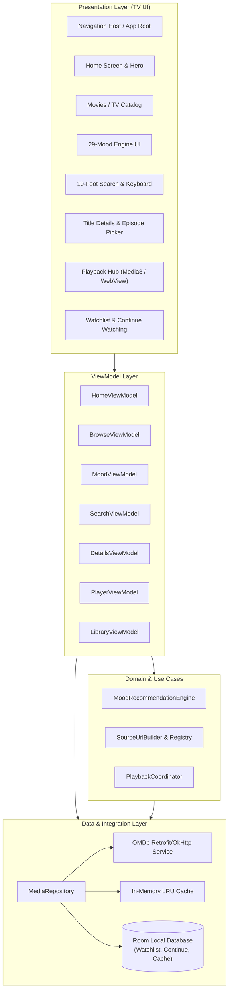
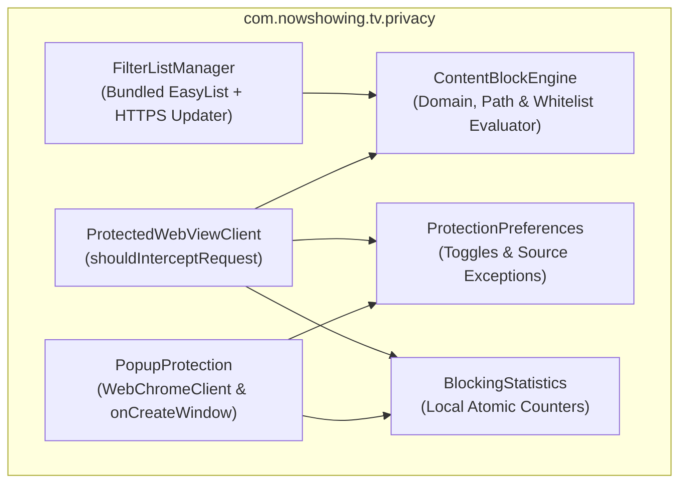

> **October 17, 2026 playback update:** See [WEB_PLAYBACK.md](WEB_PLAYBACK.md) for the current dual-engine playback contract. Earlier native-only / zero-WebView requirements below are historical and superseded. Real-provider TV testing remains required.

# Architecture Specification: NowShowing TV

## 1. System Overview & Clean Architecture

NowShowing TV is structured using Clean Architecture and the MVVM (Model-View-ViewModel) pattern, tailored specifically for Android TV's single-activity remote-navigation lifecycle.



## 2. Layer Responsibilities

### 2.1. Presentation Layer
- **TV Leanback & Compose UI**: High-contrast, large-format UI components styled for 10-foot viewing.
- **Focus Engine**: Focusable components maintain highlighted glow/elevation states and explicitly coordinate D-pad transitions.
- **ViewModels**: Expose reactive `StateFlow<UiState>` streams to screens. Handle asynchronous loading, error states, and pagination without blocking the main thread.

### 2.2. Domain Layer
- **MoodRecommendationEngine**:
  - Implements the exact 29-mood mapping from the web application.
  - Generates candidate query sets, deduplicates, invokes batch detail enrichment, computes genre intersection score (`_matchScore`), and orders results by `matchScore DESC, rating DESC`.
- **SourceUrlBuilder & SourceRegistry**:
  - Encapsulates URL formatting logic for all 11 video sources (`vidsrc.to`, `vidsrc.icu`, `vidsrc.me`, `autoembed.co`, `2embed.cc`, `2embed.stream`, `vidsrc.xyz`, `moviesapi.club`, `multiembed.mov`, `embed.su`, `vidsrc.mov`).
  - Constructs appropriate movie and series paths (injecting `season` and `episode`).
- **PlaybackCoordinator**:
  - Manages playback source selection, fallback rotation upon error, and hands off streams to either the native Media3 engine or the TV WebView engine.

### 2.3. Data Layer
- **OMDb Client (`OmdbApiService`)**:
  - Configured with OkHttp connection pooling, exponential backoff retries, and request deduplication.
  - Endpoints: Search (`s=`, `page=`, `type=`), Details (`i=`, `plot=full`), Season (`i=`, `Season=`), Title lookup (`t=`).
- **Two-Tier Caching System**:
  - **L1 In-Memory Cache**: 10-minute TTL for fast navigation between tabs.
  - **L2 Persistent Room Cache**: LRU-evicted SQLite table caching OMDb title summaries and mood genre mappings to minimize API quota consumption.
- **Room Database Entities**:
  - `WatchlistItemEntity`: Stores IMDb ID, Title, Poster, Year, Type, DateAdded.
  - `ContinueWatchingEntity`: Stores IMDb ID, Title, Poster, Year, Type, Season, Episode, LastPositionMs, DurationMs, UpdatedAt.
  - `MetadataCacheEntity`: Stores request key, JSON payload, and expiration timestamp.
  - `SearchHistoryEntity`: Stores query string and search timestamp.

### 2.4. Native-Only Playback Architecture

```mermaid
flowchart TD
    Select["Movie / Episode Selected"] --> Resolver["MediaSourceResolver\n(Protocol & Format Check)"]
    
    Resolver --> Check{"Source Compatible?"}
    
    Check -->|Native Stream (HLS/DASH/MP4)| Validator["SourceValidation\n(HTTPS, Hop Limit, Non-Ad Check)"]
    Check -->|Unsupported Web Embed| Incompatible["Incompatible Source Screen\n'Native playback unavailable.\nTry another source.'"]
    
    Validator --> Media3["AndroidX Media3 (ExoPlayer)\n(100% Native TV Surface)"]
    Incompatible --> Switcher["D-Pad Source Switcher\n(Select Compatible Native Stream)"]
    Switcher --> Resolver
    
    Media3 --> Controls["10-Foot Remote D-Pad HUD\n(Seek ±10s, Timeline, Episodes)"]
    Media3 --> Progress["Persist Progress & Resume (Room DB)"]
```

1. **Mandatory Native Player (AndroidX Media3 / ExoPlayer)**:
   - Primary and exclusive in-app playback engine. Zero WebViews, zero HTML/DOM execution, and zero browser pop-ups.
   - Decodes hardware-accelerated HLS (`.m3u8`), MPEG-DASH (`.mpd`), and progressive MP4 streams.
   - Provides native TV controls: timeline scrubber, Play/Pause, 10s skip (with on-screen feedback pill), Next/Previous episode sequencing, and audio/subtitle selection.
   - Emits playback milestones to update `ContinueWatchingEntity`.
2. **Media Source Resolution Layer (`com.nowshowing.tv.playback`)**:
   - `MediaSourceResolver`: Validates configured providers. Direct streams proceed to playback; legacy iframe web embeds (e.g. VidSrc, AutoEmbed) are safely rejected before any network content is rendered.
   - `SourceValidation`: Enforces HTTPS protocols (allowing RFC-1918 private IPs for local media servers), limits redirect depth to 5 hops, and ensures destinations do not resolve to known advertising/tracking domains.
   - `PlaybackCoordinator`: Orchestrates fallback to compatible native streams, next/previous episode calculations, and 30-second next-episode prompts.
3. **Safe Incompatible State Handling**:
   - When a user chooses an unsupported web embed or an unplayable source, the app displays a focused TV error card with one-click D-pad actions to switch to a compatible native stream without leaving the player experience.

## 3. Privacy & Content Blocking Subsystem



## 4. Directory Layout in Repository
The Android TV project is self-contained in `android-tv/`:
```
android-tv/
├── build.gradle.kts
├── settings.gradle.kts
├── gradle/
│   └── wrapper/
├── app/
│   ├── build.gradle.kts
│   ├── proguard-rules.pro
│   └── src/
│       ├── main/
│       │   ├── AndroidManifest.xml
│       │   ├── java/com/nowshowing/tv/
│       │   │   ├── NowShowingApp.kt
│       │   │   ├── data/
│       │   │   │   ├── api/
│       │   │   │   ├── db/
│       │   │   │   ├── model/
│       │   │   │   └── repository/
│       │   │   ├── domain/
│       │   │   │   ├── model/
│       │   │   │   ├── mood/
│       │   │   │   └── source/
│       │   │   ├── playback/
│       │   │   │   ├── Media3PlayerEngine.kt
│       │   │   │   ├── TvWebViewPlayerEngine.kt
│       │   │   │   └── PlaybackCoordinator.kt
│       │   │   └── ui/
│       │   │       ├── common/
│       │   │       ├── home/
│       │   │       ├── browse/
│       │   │       ├── mood/
│       │   │       ├── search/
│       │   │       ├── details/
│       │   │       ├── player/
│       │   │       ├── library/
│       │   │       └── theme/
│       │   └── res/
│       │       ├── drawable/
│       │       ├── layout/
│       │       ├── values/
│       │       └── xml/
│       └── test/
```
